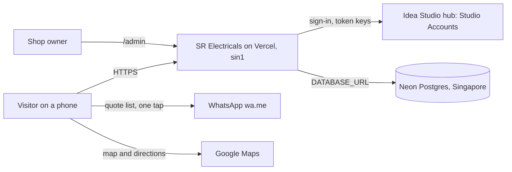
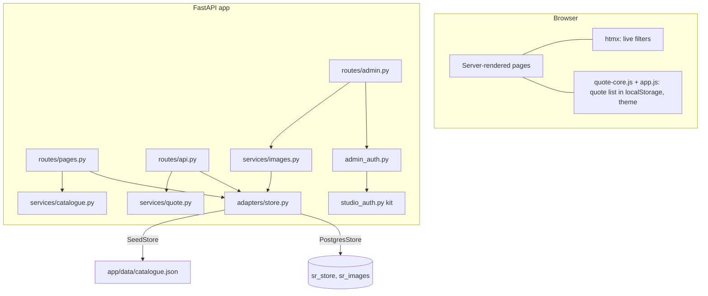

# SR Electricals: Architecture

Last updated by CR-0001.

## Context

Who and what the system talks to.

## Components

| Component | Responsibility | Code |
|---|---|---|
| Pages | Home, catalogue, category, brand, product, quote list, 404, uploaded images | `app/routes/pages.py`, `app/templates/` |
| API | Product list JSON; WhatsApp link builder (no storage) | `app/routes/api.py` |
| Admin | Owner screens: lists, forms, uploads, settings, export | `app/routes/admin.py`, `app/templates/admin/` |
| Admin access | Signed-in owner or admin only; previews open | `app/admin_auth.py`, `app/studio_auth.py` |
| Catalogue store | Load and save the catalogue and images | `app/adapters/store.py` |
| Models | Settings, brands, categories, products, data version | `app/models.py` |
| Search | Filters and word search | `app/services/catalogue.py` |
| Images | Type and size check, resize, WebP | `app/services/images.py` |
| Quote message | WhatsApp text and link | `app/services/quote.py`, `public/static/quote-core.js` |

## Data model
One catalogue document (see [SPEC data model](../spec/SPEC.md#data-model) and [ADR-0003](../adr/0003-storage.md)):

- `settings`: shop name, tagline, owner name and photo, story, address parts, map query, phone, WhatsApp, open days, opens, closes, who we serve.
- `brands[]` in display order: slug, name, logo (unused until permission), active.
- `categories[]` in display order: slug, name, image, description, best_selling, active.
- `products[]` in display order (newest first): id, slug, name, brand_slug, category_slug, specs, price_inr, unit, bulk_available, best_selling, image, active, updated_at.
- A product is shown only if it, its brand and its category are all active and present.

Postgres: `sr_store(key text primary key, data jsonb, updated_at)` with one row `catalogue`; `sr_images(id text primary key, data bytea, mime, created_at)`.

Routes: `GET /`, `/products?q&category&brand`, `/products/{slug}`, `/category/{slug}`, `/brand/{slug}`, `/quote`, `/img/{id}.webp`, `/healthz`, `/api/health`, `GET /api/products`, `POST /api/whatsapp-link` (JSON body; POST rather than the spec outline's GET because it takes a list), `/admin`, `/admin/products[/new|/{id}|/{id}/remove]`, `/admin/brands…`, `/admin/categories…` (plus `/move`), `/admin/settings`, `POST /admin/owner-photo`, `/admin/export`, and the kit's `/auth/callback`, `/auth/me`, `/auth/logout`.

## Integrations and adapters
External services sit behind adapters so they can be mocked in tests and demos and swapped for real ones later.

| Integration | Adapter | Current mode | To go live |
|---|---|---|---|
| Postgres (Neon) | `CatalogueStore` / `PostgresStore` | Seed catalogue, read-only (no `DATABASE_URL` yet) | Founder links the Neon database to the Vercel project; next load seeds the tables |
| Studio Accounts | `studio_auth.py` kit + `admin_auth.py` | Live hub; tests mock it | Founder adds Sanjay Singh in hub `/admin/users` with the owner (or App admin) role |
| WhatsApp | Plain `https://wa.me/` link | Live (opens WhatsApp with the message; nothing stored) | Nothing |
| Google Maps | Embed and directions links | Live (no key needed) | Nothing |

## Key flows
1. **Quote:** visitor taps Add (or sets a quantity on the product page) → list saved in the browser → Quote list page → optional name and buyer type → Send on WhatsApp opens `wa.me/91…?text=…` with the formatted list.
2. **Owner edit:** owner opens `/admin` → redirected to Studio sign-in → back with a session cookie → edits a product → the store saves the catalogue → redirect with "Saved" → the next public page load shows it.
3. **Upload:** file checked (type, 2 MB) → resized to ≤1600 px WebP → stored in `sr_images` → served at `/img/<id>.webp`.

## Quality attributes
- **Speed:** server-rendered HTML, about 25 KB CSS and JS of our own plus htmx, small SVG pictures, lazy images, fonts preloaded and self-hosted. Function in `sin1` next to the database.
- **Privacy:** no customer data on the server; the quote list lives only in the browser. Only the shop's business phone is shown, with the owner's consent.
- **Security:** admin needs a signed token from the hub with the owner or admin role; cookies are HttpOnly and SameSite=Lax (cross-site form posts don't carry them); uploads are decoded by Pillow and re-encoded; no secrets in the repo.
- **Accessibility:** labels on every control, alt text, AA contrast for both themes (tested), visible focus ring, 44 px targets, reduced motion respected.
- **Verified by:** `tests/` (pytest and node), `scripts/visual_check.py` (real browser at 360, 375 and 1280 px, light and dark).

## Decisions
See [../adr/](../adr/). The most important so far:
- [ADR-0001](../adr/0001-spec-driven-development.md) Spec-driven development
- [ADR-0002](../adr/0002-stack.md) Tier H: FastAPI + Jinja2 + HTMX
- [ADR-0003](../adr/0003-storage.md) Catalogue as one JSON document in Postgres; read-only seed without a database
